# Sprint 3: rediseño Innovacred, actividades económicas e informe de deudas

**Comparación:** lo publicado en el commit [`43e81f2`](https://github.com/coyane/risktech/commit/43e81f2) (fin del sprint 2) frente al estado actual del prototipo. Las capturas de las dos versiones se tomaron con el mismo caso de ejemplo, a 1440 × 900 y 375 × 812, y están en `docs/sprint-3/` (`antes-*` y `despues-*`).

Este documento no reemplaza al de fórmulas (`docs/sprint-2-formulas-del-metodo.md`): **ninguna fórmula del sprint 2 cambió**. Lo nuevo de cálculo es solo el plazo transcurrido del crédito (S3-07), que queda "por confirmar".

## Resumen del sprint

| | Antes (sprint 2) | Ahora (sprint 3) |
| --- | --- | --- |
| Marca | CEFT | Innovacred |
| Lenguaje | "Método ICRED", "Capítulo IV", "reglas del método" en pantalla, PDF y CSV | El cálculo y su origen (formulario, código, año). Ningún texto visible nombra un método |
| Sistema visual | IBM Plex, azul marino con acento azul, menú lateral oscuro | Bricolage Grotesque + Instrument Sans, paleta petróleo, panel con tarjetas sobre lienzo gris |
| Navegación | Pestañas arriba más menú lateral con "En este informe" | Menú lateral agrupado (Diagnóstico, Informe, Complementos); barra inferior en móvil |
| Resumen | Nueve tarjetas iguales y tabla por año | Panel: cuatro cifras con variación entre años, actividades económicas, barras por año, tasa y plazo, tasa efectiva, propiedades y deuda |
| Cálculos | Índice de 21 bloques y explicación completa siempre abierta | Por grupos y por niveles: primero la respuesta, la operación y el origen al pedirlos |
| Crédito | Campos, tres cifras y la explicación | Monto protagonista con campos, curva del crédito según el plazo y factores leverage como cifras |
| Propiedades | Subpestaña dentro de Datos del SII, tabla de 10 columnas | Vista propia con cifras, barra de pago, deuda por institución y tabla con encabezados, barra de financiado y plazo transcurrido |
| Actividades económicas | Solo en Datos del SII, sin "afecta IVA", leídas en el paso de bienes raíces | Paso propio de la extracción, tarjeta en el Resumen y columna "Afecta IVA" |
| Informe de deudas de la CMF | No existía | Vista nueva, opcional: guía con la URL exacta, carga del PDF, verificación por QR y páginas al final del PDF del informe |
| Pruebas | 18 unitarias, 40 de interfaz | 39 unitarias, 87 de interfaz (1440 y 375 px) |

## Reglas de producto que cambiaron

Están en `docs/product.md`; ambas las decidió Cristóbal en este sprint.

1. **Variación entre años, permitida como dato.** La regla 1 decía "sin comparaciones entre años". Ahora se permite mostrar la variación ("+11,9% vs AT 2024") en color neutro, sin flechas ni adjetivos, con un botón que la oculta. Nunca como evaluación.
2. **La interfaz habla del cálculo y de su origen, no de un método** (regla 7 nueva). Ningún texto de pantalla, PDF ni CSV nombra el Método ICRED, el Capítulo IV, "el método", sus reglas ni casos de referencia. La documentación interna sí puede nombrarlos. Una prueba unitaria falla si el registro de cálculos vuelve a usar esas palabras.

Se agregó además el **informe de deudas de la CMF** como complemento opcional de la fase 1 (S3-08 y S3-09).

## Orden sugerido y dependencias

```
S3-01 Marca y lenguaje ─┐
S3-02 Sistema visual ───┼─> S3-03 Resumen ─> S3-04 Cálculos ─> S3-05 Crédito ─> S3-06 Propiedades
                        │                                                         └─> S3-07 Plazo del crédito
                        ├─> S3-10 Actividades económicas
                        └─> S3-08 Informe de deudas ─> S3-09 Verificación por QR
S3-11 Landing e ingreso (siguiente sprint, en Astro)
```

S3-01 y S3-02 son la base de todo lo visual. S3-07, S3-09 y S3-10 traen trabajo de backend: extracción, cálculo y verificación.

## Convenciones de los tickets

- **Dónde verlo:** entrar a `/diagnostico` con cualquier RUT válido en modo demo (por ejemplo, 12.345.678-5). Cada vista tiene dirección propia con `#`.
- **Commit:** todo el sprint está en [`5757147`](https://github.com/coyane/risktech/commit/575714737a40ab53377b45f43f176f4b51fe956c) (`main`, 2026-10-27).
- **Mapa de código:** cada ticket trae una tabla "Código" con las piezas de UI y UX y su enlace a las líneas exactas. Los enlaces están fijados al commit 5757147, así que muestran el código del sprint aunque después cambie; para la versión vigente, abrir el mismo archivo en `main`.
- **Estados de cálculo:** se mantienen. Calculado, Por confirmar (falta confirmar un dato o un supuesto) y Por determinar (falta un dato o la forma de calcularlo).
- **Verificación de todos los tickets:** `npm run verify:ui` en verde y revisión de la pantalla a 1440 y 375 px.

---

## S3-01 · Marca Innovacred y lenguaje sin método

**Por qué.** La plataforma pasa a llamarse Innovacred. Además, la persona necesita entender el cálculo y de dónde sale el dato, no el nombre de una metodología.

| Antes | Ahora |
| --- | --- |
| 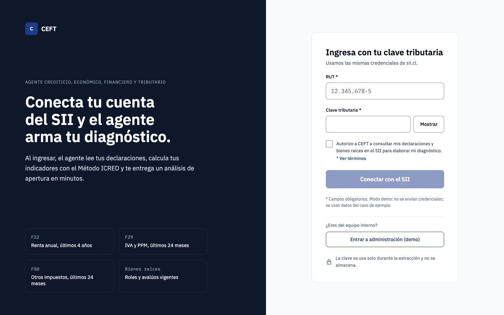 | 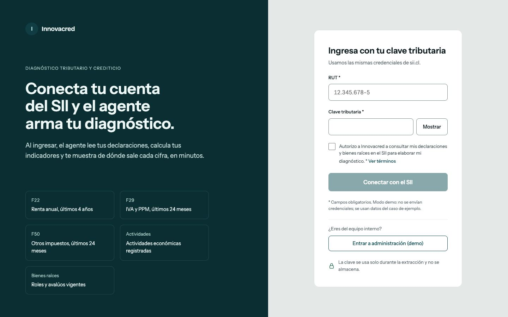 |

**Qué cambió**

- Innovacred reemplaza a CEFT en todo lo visible: título del documento, menú, ingreso, backoffice, PDF, nombre del CSV (`innovacred-diagnostico-base.csv`), favicon y claves de `sessionStorage` (`innovacred.*`).
- Antes, el ingreso decía "calcula tus indicadores con el Método ICRED", el encabezado del informe "Diagnóstico Base · Método ICRED · Capítulo IV" y la extracción "Cálculo Método ICRED". Todo eso salió.
- Las definiciones, frases, estados y avisos del registro (`src/lib/calculos.ts`) se reescribieron para hablar del dato y su origen:
  - "Referencia del Capítulo IV" pasa a "Tasa y plazo de referencia";
  - "Por confirmar" pasa a "Falta confirmar un dato o un supuesto de este cálculo".
- Repositorio y carpetas siguen llamándose Risktech y `risktech-ceft`.

**Criterios de aceptación**

- [ ] Ninguna pantalla, PDF ni CSV contiene "ICRED", "Capítulo IV", "CEFT" ni "método". La prueba e2e lo revisa en el informe y en el ingreso; la unitaria, en el registro.
- [ ] Los textos fijos son idénticos para dos casos distintos (prueba unitaria).
- [ ] `docs/product.md` tiene la regla 7.

**Archivos:** `src/lib/calculos.ts`, `src/data/demo.json`, `src/pages/LoginPage.tsx`, `index.html`, `public/favicon.svg`, `docs/product.md`.

**Código** (commit 5757147)

| Pieza | Para qué sirve (UI/UX) | Código |
| --- | --- | --- |
| Textos fijos: estados y tipos de dato | UX: cómo se explica cada estado y tipo de dato, sin método | [`calculos.ts` L113–124](https://github.com/coyane/risktech/blob/575714737a40ab53377b45f43f176f4b51fe956c/src/lib/calculos.ts#L113-L124) |
| Origen de tasa y plazo | UX: "Tasa y plazo de referencia" / "escritos en este informe" | [`calculos.ts` L183–189](https://github.com/coyane/risktech/blob/575714737a40ab53377b45f43f176f4b51fe956c/src/lib/calculos.ts#L183-L189) |
| Marca | UI: nombre de la plataforma en un solo lugar | [`ShellFrame.tsx` L5](https://github.com/coyane/risktech/blob/575714737a40ab53377b45f43f176f4b51fe956c/src/components/ShellFrame.tsx#L5) |
| Prueba: sin método ni marcas de terceros | Regla 7 automatizada | [`calculos.test.ts` L333–370](https://github.com/coyane/risktech/blob/575714737a40ab53377b45f43f176f4b51fe956c/src/lib/__tests__/calculos.test.ts#L333-L370) |
| Prueba: textos idénticos entre casos | Determinismo de los textos | [`calculos.test.ts` L317–321](https://github.com/coyane/risktech/blob/575714737a40ab53377b45f43f176f4b51fe956c/src/lib/__tests__/calculos.test.ts#L317-L321) |
| Prueba e2e: ninguna pantalla nombra el método | Informe completo | [`diagnostico.spec.ts` L32–35](https://github.com/coyane/risktech/blob/575714737a40ab53377b45f43f176f4b51fe956c/e2e/diagnostico.spec.ts#L32-L35) |
| Prueba e2e: ingreso con marca nueva | Pantalla de conexión | [`diagnostico.spec.ts` L296–301](https://github.com/coyane/risktech/blob/575714737a40ab53377b45f43f176f4b51fe956c/e2e/diagnostico.spec.ts#L296-L301) |
| Regla de producto 7 | Documento de producto | [`product.md` L64](https://github.com/coyane/risktech/blob/575714737a40ab53377b45f43f176f4b51fe956c/docs/product.md?plain=1#L64) |

---

## S3-02 · Sistema visual nuevo y marco de la aplicación

**Por qué.** La base visual venía de Kupera (pensada para abogados) y se sentía sobria en exceso. Se buscó algo más moderno sin perder confianza de producto financiero. La dirección final, "Panel", salió de cuatro rondas de prototipos y de tres referencias de Dribbble (Task Management Dashboard, Personal Finance Management y App Metrics Dashboard).

| Antes | Ahora |
| --- | --- |
| 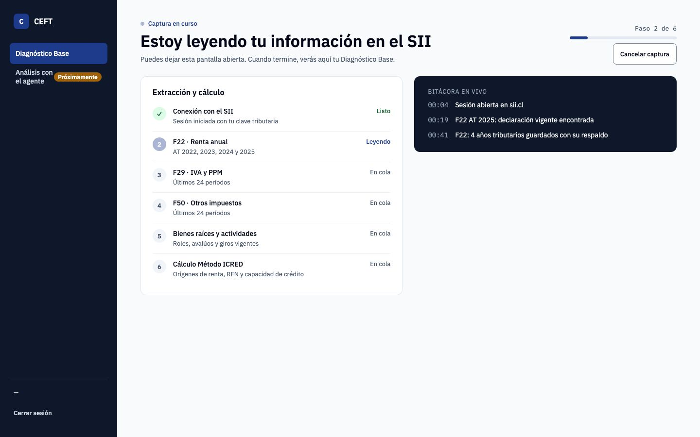 | 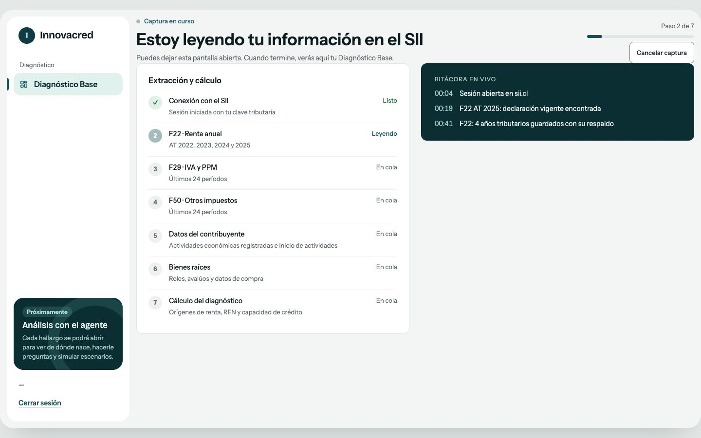 |

**Qué cambió**

- **Tipografía:** Bricolage Grotesque (títulos y cifras) e Instrument Sans (texto), servidas localmente con `@fontsource`. Se quitó IBM Plex Sans y Mono.
- **Paleta:** petróleo (`#0b2e33` a `#e1f2ee`) sobre un lienzo gris verdoso. Los estados siguen con ícono y texto.
- **Marco (`ShellFrame`):**
  - menú lateral en tarjeta con grupos Diagnóstico, Informe y Complementos, más el agente "Próximamente" al pie;
  - barra superior con el caso, los años, PDF, CSV y "Nueva captura";
  - bajo 1024 px, botón "Menú" (hoja) y barra inferior con las cuatro vistas más "Más".
- **Backoffice:** usa el mismo marco y la misma marca.
- **Se eliminaron piezas sin uso:**
  - componentes: `CalcBlock`, `CalcExplorer`, `Equation`, `PendingSection` y `MoneyWaterfall`;
  - estilos: `calc.css`, `calc-visuals.css`, `explorer.css` y `report-extras.css`.
- **Pieza nueva:** `Icon` reemplaza los íconos sueltos (SVG de una familia, sin emoji).

**Criterios de aceptación**

- [ ] Sin desplazamiento horizontal a 375 y 1440 px en ninguna vista.
- [ ] El menú se desplaza dentro de su tarjeta si no cabe en la altura; nada se recorta.
- [ ] El agente sigue visible como "Próximamente".
- [ ] El sistema de diseño (`design-system/risktech-ceft/MASTER.md`) describe la tipografía y la paleta nuevas.

**Archivos:** `src/styles/tokens.css`, `shell.css`, `panel.css`, `src/components/ShellFrame.tsx`, `AppShell.tsx`, `AdminShell.tsx`, `src/components/Icon.tsx`, `package.json`.

**Código** (commit 5757147)

| Pieza | Para qué sirve (UI/UX) | Código |
| --- | --- | --- |
| Tokens: paleta, tipografía, espacios | UI: todos los valores visuales del sistema | [`tokens.css` L1–83](https://github.com/coyane/risktech/blob/575714737a40ab53377b45f43f176f4b51fe956c/src/styles/tokens.css#L1-L83) |
| Marco: menú lateral, barra superior, hoja y barra inferior | UI/UX: navegación en escritorio y móvil | [`ShellFrame.tsx` L11–127](https://github.com/coyane/risktech/blob/575714737a40ab53377b45f43f176f4b51fe956c/src/components/ShellFrame.tsx#L11-L127) |
| Estilos del marco | UI: tarjeta del menú, grupos, barra inferior | [`shell.css` L1–409](https://github.com/coyane/risktech/blob/575714737a40ab53377b45f43f176f4b51fe956c/src/styles/shell.css#L1-L409) |
| Menú del diagnóstico (grupos y rótulos) | UX: Diagnóstico, Informe, Complementos y agente "Próximamente" | [`AppShell.tsx` L26–149](https://github.com/coyane/risktech/blob/575714737a40ab53377b45f43f176f4b51fe956c/src/components/AppShell.tsx#L26-L149) |
| Vistas y grupos del menú | Orden y agrupación de las vistas | [`reportViews.ts` L9–18](https://github.com/coyane/risktech/blob/575714737a40ab53377b45f43f176f4b51fe956c/src/lib/reportViews.ts#L9-L18) |
| Íconos | UI: familia única de íconos SVG | [`Icon.tsx` L1–49](https://github.com/coyane/risktech/blob/575714737a40ab53377b45f43f176f4b51fe956c/src/components/Icon.tsx#L1-L49) |
| Piezas del panel (tarjeta, cifra, flecha, variación, forma de dato) | UI: componentes base reutilizables | [`Bits.tsx` L1–64](https://github.com/coyane/risktech/blob/575714737a40ab53377b45f43f176f4b51fe956c/src/components/panel/Bits.tsx#L1-L64) |
| Estilos del panel | UI: tarjetas, cifras, barras, niveles | [`panel.css` L1–1956](https://github.com/coyane/risktech/blob/575714737a40ab53377b45f43f176f4b51fe956c/src/styles/panel.css#L1-L1956) |
| Sistema de diseño (reglas visuales) | Guía para devs y diseño | [`MASTER.md` L1–64](https://github.com/coyane/risktech/blob/575714737a40ab53377b45f43f176f4b51fe956c/design-system/risktech-ceft/MASTER.md?plain=1#L1-L64) |
| Prueba e2e: sin desplazamiento horizontal | 375 y 1440 px | [`diagnostico.spec.ts` L204–213](https://github.com/coyane/risktech/blob/575714737a40ab53377b45f43f176f4b51fe956c/e2e/diagnostico.spec.ts#L204-L213) |

---

## S3-03 · Resumen como panel

**Por qué.** El Resumen anterior mostraba nueve tarjetas del mismo peso, sin decir que seis forman una sola cadena (ingreso → impuesto → renta neta → dividendo → crédito). El crédito, que es lo que más importa, no se podía ajustar ahí. Hubo una versión intermedia en cinco pasos con línea técnica y frases puente, pero se descartó por sobrecargada.

| Antes | Ahora |
| --- | --- |
| 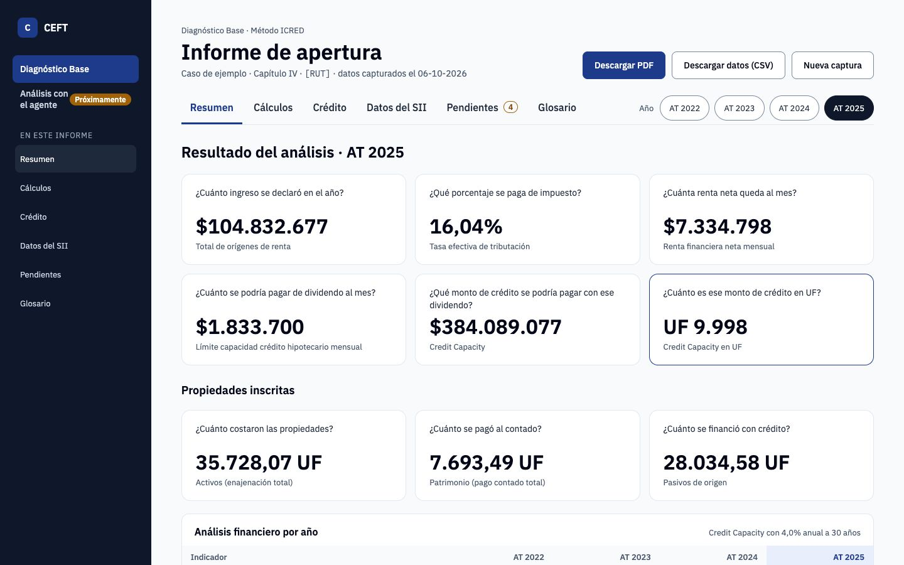 | 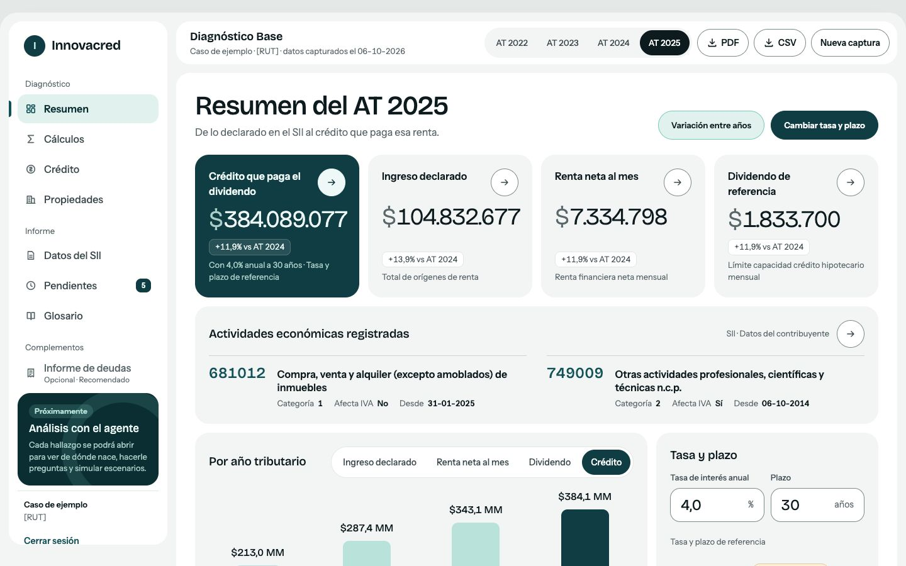 |
| 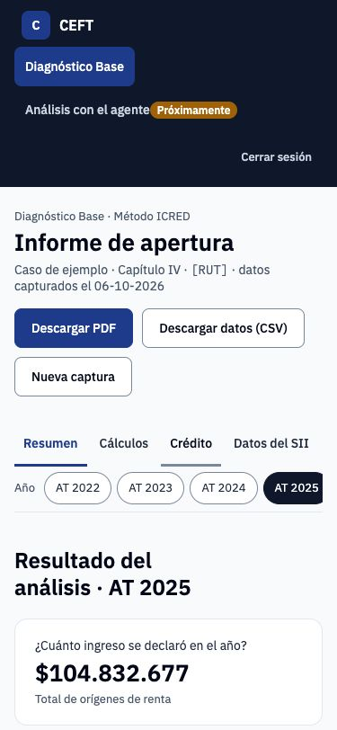 | 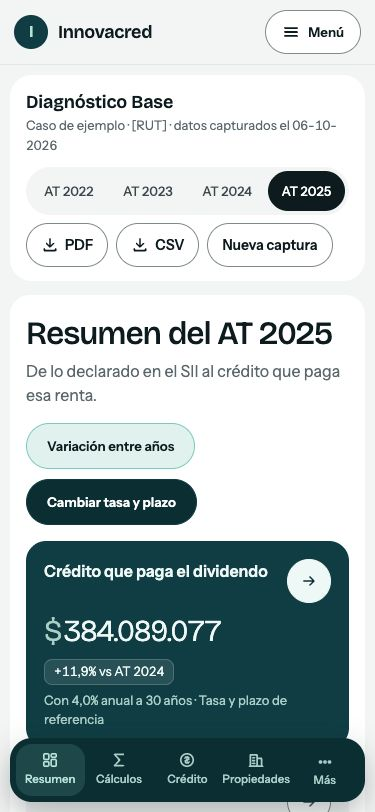 |

**Qué cambió**

- **Cuatro cifras arriba:** crédito que paga el dividendo (rellena, la protagonista), ingreso declarado, renta neta al mes y dividendo de referencia. Cada una con su variación frente al año anterior en neutro y una flecha a su cálculo. El botón "Variación entre años" la muestra u oculta.
- **Actividades económicas registradas:** tarjeta a todo el ancho (ver S3-10).
- **"Por año tributario":** barras con base cero y botones para elegir la cifra (ingreso, renta neta, dividendo o crédito). La tabla por año queda plegada.
- **"Tasa y plazo":** los mismos campos que en Crédito, sincronizados entre ambas vistas, con "Por confirmar" junto al valor en UF.
- **Tasa efectiva:** una barra donde todo el ancho es la base imponible (código 170) y la parte rellena es el impuesto (código 157).
- **Propiedades:** barra partida con lo pagado al contado (liso) y lo financiado (rayado), con monto y porcentaje. Antes eran tres tarjetas.
- **Deuda de origen:** por institución, ordenada de mayor a menor, con "Leverage · Por determinar".
- **"Credit Capacity en UF" ahora muestra "Por confirmar"** en el Resumen. Antes no lo hacía, aunque la regla de producto lo exige.

**Gráficos que se probaron y salieron** (auditoría: un gráfico existe solo si responde una pregunta mejor que la cifra):

- mini tendencias en cada tarjeta, porque las cuatro tenían la misma forma y exageraban;
- medio anillo para la tasa efectiva, porque sugiere un rango y una evaluación;
- anillo de propiedades, porque dos partes se leen mejor en barra.

**Criterios de aceptación**

- [ ] Con AT 2025: crédito $384.089.077, ingreso $104.832.677, renta neta al mes $7.334.798, dividendo $1.833.700.
- [ ] Escribir 3,75% y 23 años en el Resumen da $338.765.923, y la vista Crédito muestra lo mismo.
- [ ] La variación se oculta con el botón y, en AT 2022, dice "Primer año del informe".
- [ ] Las barras por año parten de cero.

**Archivos:** `src/pages/DiagnosticoPage.tsx`, `src/components/panel/Bits.tsx`, `src/components/panel/Charts.tsx`, `src/lib/variacion.ts`, `src/lib/useCreditDraft.ts`, `src/components/SplitBar.tsx`.

**Código** (commit 5757147)

| Pieza | Para qué sirve (UI/UX) | Código |
| --- | --- | --- |
| Vista Resumen completa | UI/UX: composición del panel | [`DiagnosticoPage.tsx` L393–497](https://github.com/coyane/risktech/blob/575714737a40ab53377b45f43f176f4b51fe956c/src/pages/DiagnosticoPage.tsx#L393-L497) |
| Tarjeta de cifra (Kpi) | UI: cifra, variación y flecha al cálculo | [`DiagnosticoPage.tsx` L834–862](https://github.com/coyane/risktech/blob/575714737a40ab53377b45f43f176f4b51fe956c/src/pages/DiagnosticoPage.tsx#L834-L862) |
| Tasa efectiva como barra | UI: base 170 y impuesto 157 | [`DiagnosticoPage.tsx` L865–892](https://github.com/coyane/risktech/blob/575714737a40ab53377b45f43f176f4b51fe956c/src/pages/DiagnosticoPage.tsx#L865-L892) |
| Barras por año | UI: base cero, selector de cifra | [`Charts.tsx` L5–45](https://github.com/coyane/risktech/blob/575714737a40ab53377b45f43f176f4b51fe956c/src/components/panel/Charts.tsx#L5-L45) |
| Variación entre años | Lógica: dato neutro, "Primer año del informe" | [`variacion.ts` L1–24](https://github.com/coyane/risktech/blob/575714737a40ab53377b45f43f176f4b51fe956c/src/lib/variacion.ts#L1-L24) |
| Tasa y plazo compartidos | Lógica: sincronía Resumen ↔ Crédito | [`useCreditDraft.ts` L37–66](https://github.com/coyane/risktech/blob/575714737a40ab53377b45f43f176f4b51fe956c/src/lib/useCreditDraft.ts#L37-L66) |
| Barra partida | UI: liso al contado, rayado financiado | [`SplitBar.tsx` L1–42](https://github.com/coyane/risktech/blob/575714737a40ab53377b45f43f176f4b51fe956c/src/components/SplitBar.tsx#L1-L42) |
| Prueba e2e: variación neutra | — | [`diagnostico.spec.ts` L37–47](https://github.com/coyane/risktech/blob/575714737a40ab53377b45f43f176f4b51fe956c/e2e/diagnostico.spec.ts#L37-L47) |
| Prueba e2e: gráfico por año | — | [`diagnostico.spec.ts` L49–55](https://github.com/coyane/risktech/blob/575714737a40ab53377b45f43f176f4b51fe956c/e2e/diagnostico.spec.ts#L49-L55) |
| Prueba unitaria: variación | — | [`calculos.test.ts` L381–386](https://github.com/coyane/risktech/blob/575714737a40ab53377b45f43f176f4b51fe956c/src/lib/__tests__/calculos.test.ts#L381-L386) |

---

## S3-04 · Cálculos por niveles

**Por qué.** La vista de cálculos era la más criticada: "sobrecargada y tosca", con demasiada información a la vista en poco espacio. Toda la información sigue disponible, pero ahora se ve un nivel a la vez.

| Antes | Ahora |
| --- | --- |
| 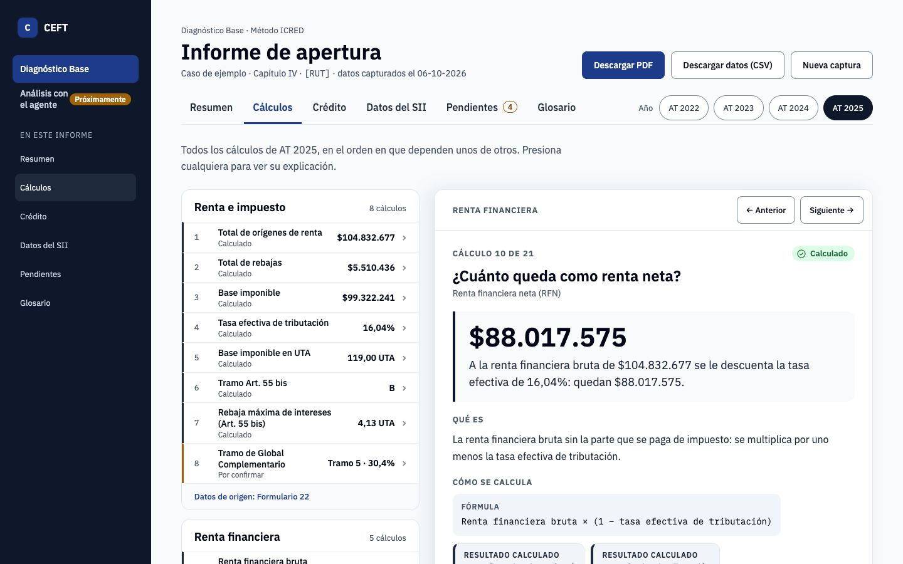 | 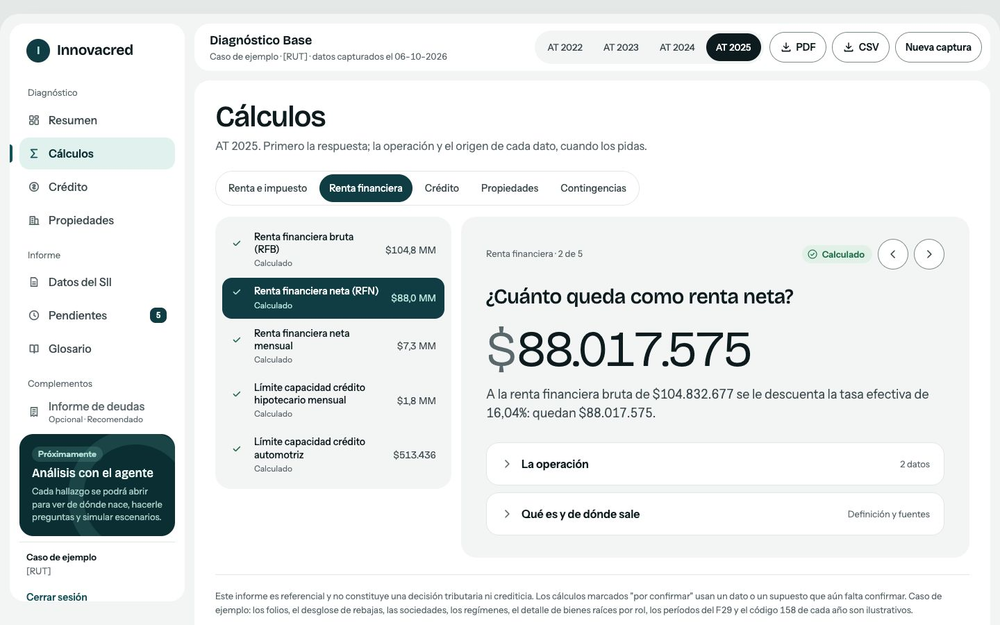 |

**Qué cambió**

- **Grupos en un control segmentado:** Renta e impuesto, Renta financiera, Crédito, Propiedades y Contingencias. Todos los cálculos se explican aquí, también los de crédito y propiedades, que antes vivían en sus vistas.
- **Índice corto por grupo:** estado, nombre y cifra abreviada ($88,0 MM).
- **El cálculo abierto, por niveles:**
  1. **La respuesta:** pregunta, cifra grande y la frase en simple del registro.
  2. **"La operación"** (plegable): fórmula en palabras y filas con operador, tipo de dato, nombre enlazado y valor, con el total bajo una línea.
  3. **"Qué es y de dónde sale"** (plegable): definición, fuentes (formulario, código, AT y folio), "Viene de" y "Se usa en".
- **Comportamiento:**
  - lo que se abre queda abierto al pasar al siguiente cálculo;
  - en móvil, el cálculo se abre como hoja a pantalla completa (se cierra con el botón, con Escape o tocando fuera);
  - anterior y siguiente dentro del grupo.
- **Tipos de dato:** dato del SII (cuadrado), valor de referencia (rombo) y resultado calculado (círculo), siempre con su etiqueta en texto.
- **Direcciones:** `#calculos`, `#grupo-<grupo>`, `#calc-<id>`. Las direcciones del sprint 2 siguen funcionando.

**Criterios de aceptación**

- [ ] `#calc-renta-neta` abre Renta financiera con "¿Cuánto queda como renta neta?" y $88.017.575, sin la operación desplegada.
- [ ] Desplegar "La operación" muestra renta financiera bruta $104.832.677 × (1 − 16,04%) = $88.017.575.
- [ ] El PDF imprime todos los cálculos con su operación y su origen desplegados.

**Archivos:** `src/components/panel/CalcLevels.tsx`, `src/lib/reportViews.ts`, `src/styles/panel.css`, `src/styles/print.css`.

**Código** (commit 5757147)

| Pieza | Para qué sirve (UI/UX) | Código |
| --- | --- | --- |
| Vista Cálculos | UI/UX: grupos, índice y cálculo abierto | [`DiagnosticoPage.tsx` L500–524](https://github.com/coyane/risktech/blob/575714737a40ab53377b45f43f176f4b51fe956c/src/pages/DiagnosticoPage.tsx#L500-L524) |
| Grupos de cálculos | Qué cálculo va en qué grupo | [`reportViews.ts` L28–46](https://github.com/coyane/risktech/blob/575714737a40ab53377b45f43f176f4b51fe956c/src/lib/reportViews.ts#L28-L46) |
| Navegación por dirección (#calc, #grupo) | UX: enlaces y botón atrás | [`reportViews.ts` L88–114](https://github.com/coyane/risktech/blob/575714737a40ab53377b45f43f176f4b51fe956c/src/lib/reportViews.ts#L88-L114) |
| Índice y hoja en móvil | UI/UX: índice corto y hoja a pantalla completa | [`CalcLevels.tsx` L418–475](https://github.com/coyane/risktech/blob/575714737a40ab53377b45f43f176f4b51fe956c/src/components/panel/CalcLevels.tsx#L418-L475) |
| Cálculo abierto (nivel 1) | UI: pregunta, cifra, frase y estado | [`CalcLevels.tsx` L303–414](https://github.com/coyane/risktech/blob/575714737a40ab53377b45f43f176f4b51fe956c/src/components/panel/CalcLevels.tsx#L303-L414) |
| "La operación" (nivel 2) | UI: filas con operador, forma de dato y total | [`CalcLevels.tsx` L81–193](https://github.com/coyane/risktech/blob/575714737a40ab53377b45f43f176f4b51fe956c/src/components/panel/CalcLevels.tsx#L81-L193) |
| "Qué es y de dónde sale" (nivel 3) | UI: definición, fuentes, viene de / se usa en | [`CalcLevels.tsx` L214–263](https://github.com/coyane/risktech/blob/575714737a40ab53377b45f43f176f4b51fe956c/src/components/panel/CalcLevels.tsx#L214-L263) |
| Forma de cada tipo de dato | UI: cuadrado, rombo, círculo | [`Bits.tsx` L44–52](https://github.com/coyane/risktech/blob/575714737a40ab53377b45f43f176f4b51fe956c/src/components/panel/Bits.tsx#L44-L52) |
| Prueba e2e: lectura por niveles | — | [`diagnostico.spec.ts` L67–90](https://github.com/coyane/risktech/blob/575714737a40ab53377b45f43f176f4b51fe956c/e2e/diagnostico.spec.ts#L67-L90) |
| Prueba e2e: hoja en móvil | — | [`diagnostico.spec.ts` L101–113](https://github.com/coyane/risktech/blob/575714737a40ab53377b45f43f176f4b51fe956c/e2e/diagnostico.spec.ts#L101-L113) |

---

## S3-05 · Crédito

| Antes | Ahora |
| --- | --- |
| 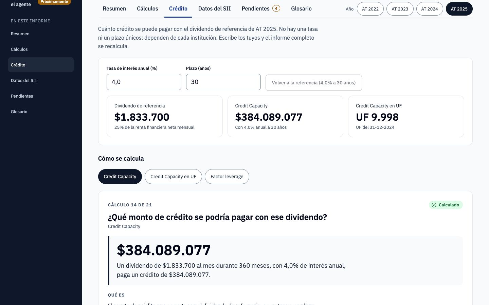 | 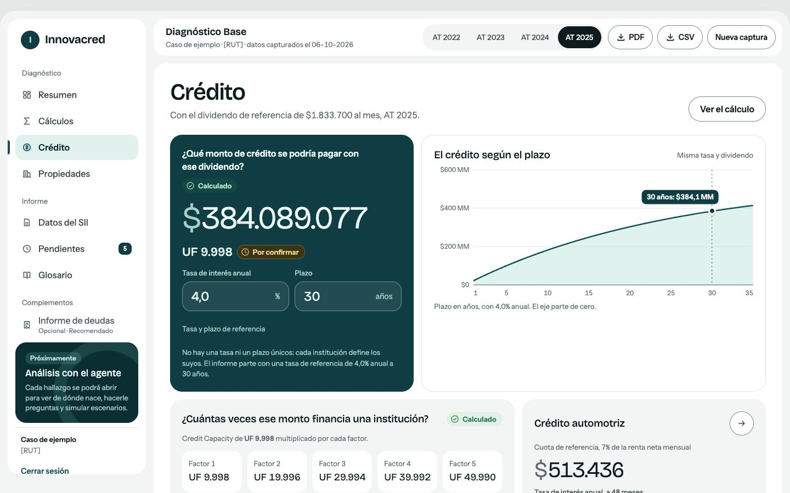 |

**Qué cambió**

- **Tarjeta petróleo:** la pregunta, el monto, la UF con "Por confirmar" y los campos de tasa y plazo (numéricos y libres, como en el sprint 2).
- **"El crédito según el plazo":** curva calculada de 1 a 35 años a la tasa escrita, con eje desde $0 y el plazo escrito marcado ("30 años: $384,1 MM"). Es de solo lectura: no es un deslizador.
- **"¿Cuántas veces ese monto financia una institución?":** factores 1 a 5 como cinco cifras en UF (antes cápsulas).
- **Crédito automotriz:** 7% de la renta neta mensual, con tasa libre. La tabla de referencia por tasa y plazo queda plegada.
- Las fórmulas son las del sprint 2 (cálculos 14, 15 y 16): no cambian.

**Criterios de aceptación**

- [ ] 3,75% y 23 años: $338.765.923 y UF 8.818, y la curva marca 23 años.
- [ ] "Volver a la referencia" vuelve a 4,0% y 30 años ($384.089.077).
- [ ] La tasa y el plazo escritos se mantienen al ir al Resumen y volver.

**Archivos:** `src/components/numbers/CreditCapacitySection.tsx`, `src/components/panel/Charts.tsx`, `src/lib/finanzas.ts` (antes `icred.ts`).

**Código** (commit 5757147)

| Pieza | Para qué sirve (UI/UX) | Código |
| --- | --- | --- |
| Vista Crédito | UI/UX: monto, campos, curva, factores, automotriz | [`DiagnosticoPage.tsx` L527–588](https://github.com/coyane/risktech/blob/575714737a40ab53377b45f43f176f4b51fe956c/src/pages/DiagnosticoPage.tsx#L527-L588) |
| Campos de tasa y plazo | UX: entrada libre, sin deslizador, validación | [`CreditCapacitySection.tsx` L21–97](https://github.com/coyane/risktech/blob/575714737a40ab53377b45f43f176f4b51fe956c/src/components/numbers/CreditCapacitySection.tsx#L21-L97) |
| Curva del crédito según el plazo | UI: eje desde $0, plazo marcado | [`Charts.tsx` L49–115](https://github.com/coyane/risktech/blob/575714737a40ab53377b45f43f176f4b51fe956c/src/components/panel/Charts.tsx#L49-L115) |
| Factores leverage como cifras | UI: cinco cifras en UF | [`DiagnosticoPage.tsx` L895–922](https://github.com/coyane/risktech/blob/575714737a40ab53377b45f43f176f4b51fe956c/src/pages/DiagnosticoPage.tsx#L895-L922) |
| Crédito automotriz | UI/UX: tasa libre | [`CreditCapacitySection.tsx` L172–219](https://github.com/coyane/risktech/blob/575714737a40ab53377b45f43f176f4b51fe956c/src/components/numbers/CreditCapacitySection.tsx#L172-L219) |
| Tabla de referencia por tasa y plazo | — | [`CreditCapacitySection.tsx` L101–169](https://github.com/coyane/risktech/blob/575714737a40ab53377b45f43f176f4b51fe956c/src/components/numbers/CreditCapacitySection.tsx#L101-L169) |
| Valor presente (fórmula) | Lógica del Credit Capacity | [`finanzas.ts` L5–9](https://github.com/coyane/risktech/blob/575714737a40ab53377b45f43f176f4b51fe956c/src/lib/finanzas.ts#L5-L9) |
| Prueba e2e: tasa y plazo recalculan todo | — | [`diagnostico.spec.ts` L136–163](https://github.com/coyane/risktech/blob/575714737a40ab53377b45f43f176f4b51fe956c/e2e/diagnostico.spec.ts#L136-L163) |

---

## S3-06 · Propiedades: vista propia y tabla que se entiende

**Por qué.** Las propiedades eran una subpestaña de Datos del SII con una tabla de 10 columnas sin explicación. La parte de "financiado o no" no se leía.

| Antes | Ahora |
| --- | --- |
| 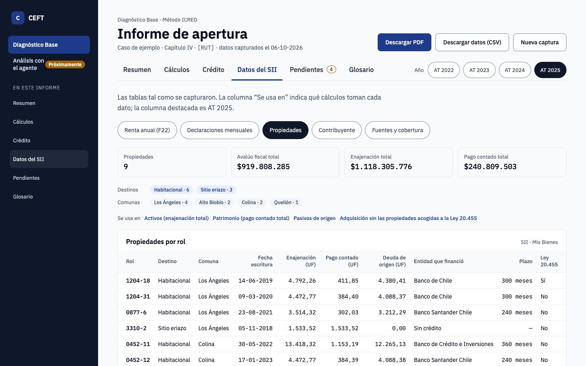 | 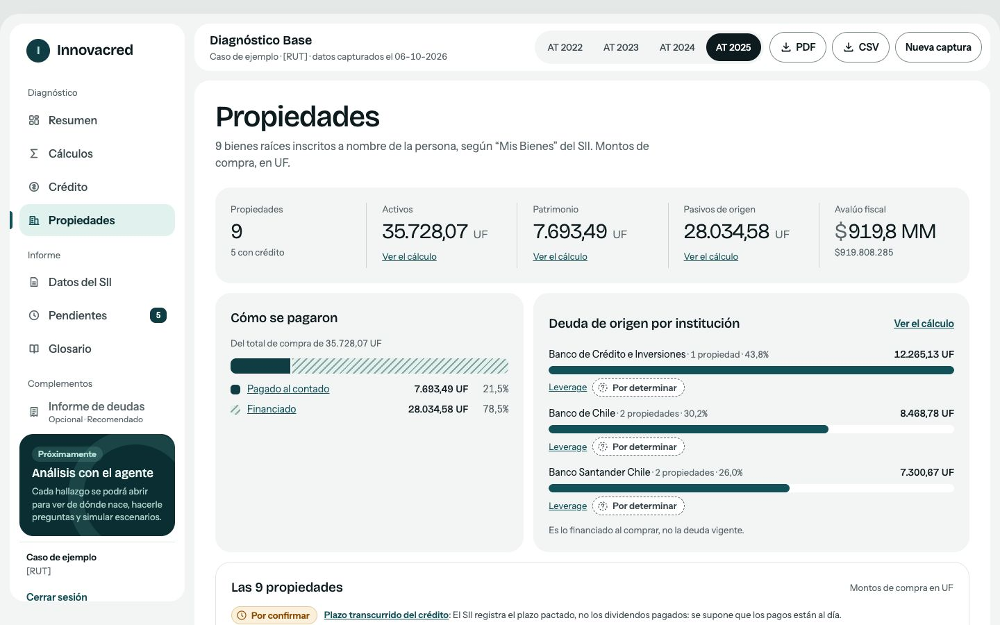 |
| 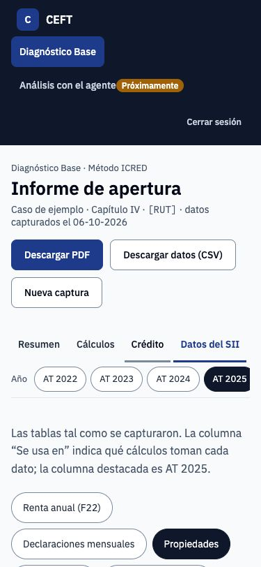 | 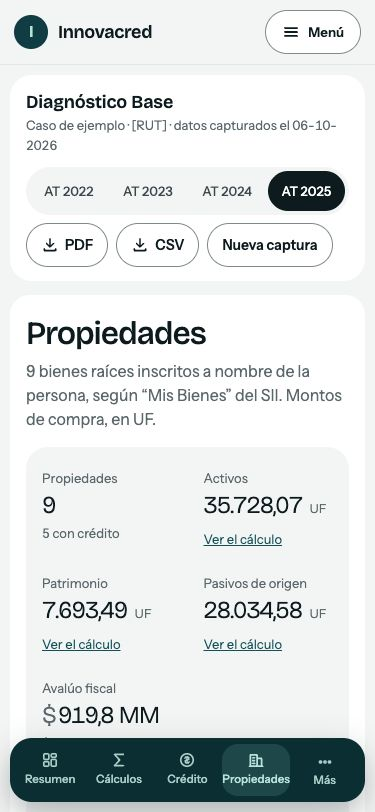 |

**Qué cambió**

- **Vista propia** en el menú: Propiedades.
- **Fila de cinco cifras:** propiedades (y cuántas con crédito), activos, patrimonio, pasivos de origen y avalúo fiscal, cada una con su enlace al cálculo.
- **"Cómo se pagaron":** barra partida, liso al contado y rayado financiado.
- **Deuda de origen por institución:** ordenada de mayor a menor, con el leverage por determinar.
- **"Las 9 propiedades":**
  - **escritorio:** tabla con encabezados (comuna y destino, compra, institución, plazo transcurrido, financiado y precio);
  - **financiado:** una mini barra liso/rayado por fila, siempre con la cifra al lado, o "Todo al contado";
  - **"¿Qué es cada columna?":** plegable, más la nota "Financiado = enajenación − pago al contado: lo financiado al comprar, no la deuda vigente";
  - **móvil:** cada propiedad es una ficha con rótulos.
- **Ficha registral de cada propiedad:** plegable. Suma la fila del plazo transcurrido.
- **Por destino, por comuna y Ley 20.455:** tres tarjetas.
- **Direcciones antiguas:** `#datos-propiedades`, `#patrimonio` y `#financiamiento` llevan a la vista nueva.

**Criterios de aceptación**

- [ ] 9 propiedades; activos 35.728,07 UF; patrimonio 7.693,49 UF; pasivos 28.034,58 UF.
- [ ] Las barras de pago suman 100%; las deudas por institución suman los pasivos.
- [ ] Encabezados visibles en escritorio y rótulos en móvil; "¿Qué es cada columna?" se despliega.

**Archivos:** `src/components/numbers/PatrimonySection.tsx` (`PropertyList` reemplaza a `PropertyTable`), `src/pages/DiagnosticoPage.tsx`, `src/lib/reportViews.ts`.

**Código** (commit 5757147)

| Pieza | Para qué sirve (UI/UX) | Código |
| --- | --- | --- |
| Vista Propiedades | UI/UX: cifras, pago, deuda, tabla, conteos | [`DiagnosticoPage.tsx` L591–656](https://github.com/coyane/risktech/blob/575714737a40ab53377b45f43f176f4b51fe956c/src/pages/DiagnosticoPage.tsx#L591-L656) |
| Tabla de propiedades (escritorio y fichas en móvil) | UI: encabezados, mini barra, plazo | [`PatrimonySection.tsx` L24–136](https://github.com/coyane/risktech/blob/575714737a40ab53377b45f43f176f4b51fe956c/src/components/numbers/PatrimonySection.tsx#L24-L136) |
| Explicación de columnas | UX: textos de "¿Qué es cada columna?" | [`calculos.ts` L155–170](https://github.com/coyane/risktech/blob/575714737a40ab53377b45f43f176f4b51fe956c/src/lib/calculos.ts#L155-L170) |
| Ficha registral | UI: antecedentes por propiedad, plegable | [`PatrimonySection.tsx` L144–201](https://github.com/coyane/risktech/blob/575714737a40ab53377b45f43f176f4b51fe956c/src/components/numbers/PatrimonySection.tsx#L144-L201) |
| Conteos por destino y comuna | UI | [`DiagnosticoPage.tsx` L952–963](https://github.com/coyane/risktech/blob/575714737a40ab53377b45f43f176f4b51fe956c/src/pages/DiagnosticoPage.tsx#L952-L963) |
| Totales de propiedades y deuda por institución | Lógica | [`patrimonio.ts` L57–105](https://github.com/coyane/risktech/blob/575714737a40ab53377b45f43f176f4b51fe956c/src/lib/patrimonio.ts#L57-L105) |
| Prueba e2e: encabezados y explicación | — | [`diagnostico.spec.ts` L368–386](https://github.com/coyane/risktech/blob/575714737a40ab53377b45f43f176f4b51fe956c/e2e/diagnostico.spec.ts#L368-L386) |
| Prueba e2e: cifras del caso | — | [`diagnostico.spec.ts` L309–316](https://github.com/coyane/risktech/blob/575714737a40ab53377b45f43f176f4b51fe956c/e2e/diagnostico.spec.ts#L309-L316) |

---

## S3-07 · Plazo transcurrido del crédito de cada propiedad

**Por qué.** Hace falta saber cuántos años lleva pagados cada crédito sobre los pactados. El SII ("Mis Bienes") registra el plazo pactado y la fecha de la escritura, **no los dividendos pagados**.

**Cálculo (estado: Por confirmar)**

```
transcurrido = meses completos entre fecha de escritura y fecha de captura
               (un mes se cumple el mismo día), con tope en el plazo pactado y mínimo 0
restante     = plazo pactado − transcurrido
fecha de escritura = fechaAdquisicion; si falta, fechaInscripcion
sin plazo pactado o sin fecha → no se calcula ("Plazo no informado en la escritura.")
```

Queda "por confirmar" porque supone que los pagos están al día. Texto fijo de la nota: "El SII registra el plazo pactado, no los dividendos pagados: se supone que los pagos están al día."

**Caso de ejemplo:** escritura del 14-06-2019, 300 meses, captura del 06-10-2026. Da 87 meses transcurridos (**7 años y 3 meses de 25 años**) y 213 restantes (17 años y 9 meses).

**Dónde se ve**

- En la tabla de Propiedades, columna "Plazo transcurrido", con una barra fina de avance.
- En la ficha registral.
- En Cálculos → Propiedades → `#calc-plazo-credito`, con la operación y el origen ("SII · Mis Bienes · escritura del 14-06-2019, plazo pactado de 25 años").

Pendientes pasa de 4 a 5.

**Backend.** Calcularlo con la misma regla en el motor, para que motor y prototipo coincidan, y registrar el commit del motor en el ticket.

**Criterios de aceptación**

- [ ] Las pruebas unitarias de `mesesEntre`, `plazoCredito` y `formatMeses` pasan: caso de ejemplo, tope en el plazo, fecha futura → 0, sin plazo → sin cálculo, sin fecha de escritura → usa la de inscripción, y singular y plural.
- [ ] La primera propiedad con crédito muestra "7 años y 3 meses de 25 años" y "Por confirmar".

**Por confirmar con Ricardo:** si se acepta suponer pagos al día, o si existe otra fuente de los dividendos pagados (por ejemplo, el informe de deudas de la CMF).

**Archivos:** `src/lib/patrimonio.ts` (`plazoCredito`, `mesesEntre`, `formatMeses`), `src/lib/calculos.ts` (`PLAZO_TEXT`, `buildPlazoCalc`), `docs/sprint-1-v2-diagnostico-base-y-backoffice.md`.

**Código** (commit 5757147)

| Pieza | Para qué sirve (UI/UX) | Código |
| --- | --- | --- |
| Meses entre fechas | Lógica: el mes se cumple el mismo día | [`patrimonio.ts` L118–122](https://github.com/coyane/risktech/blob/575714737a40ab53377b45f43f176f4b51fe956c/src/lib/patrimonio.ts#L118-L122) |
| Plazo del crédito | Lógica: tope, mínimo 0, fecha de escritura o inscripción | [`patrimonio.ts` L126–132](https://github.com/coyane/risktech/blob/575714737a40ab53377b45f43f176f4b51fe956c/src/lib/patrimonio.ts#L126-L132) |
| Formato años y meses | UX: singular y plural | [`patrimonio.ts` L135–142](https://github.com/coyane/risktech/blob/575714737a40ab53377b45f43f176f4b51fe956c/src/lib/patrimonio.ts#L135-L142) |
| Textos fijos del plazo | UX: nota del supuesto, "Por confirmar" | [`calculos.ts` L130–152](https://github.com/coyane/risktech/blob/575714737a40ab53377b45f43f176f4b51fe956c/src/lib/calculos.ts#L130-L152) |
| Cálculo explicado (#calc-plazo-credito) | Operación y origen | [`calculos.ts` L985–1028](https://github.com/coyane/risktech/blob/575714737a40ab53377b45f43f176f4b51fe956c/src/lib/calculos.ts#L985-L1028) |
| Pruebas unitarias del plazo | — | [`calculos.test.ts` L417–461](https://github.com/coyane/risktech/blob/575714737a40ab53377b45f43f176f4b51fe956c/src/lib/__tests__/calculos.test.ts#L417-L461) |
| Prueba e2e: plazo por confirmar | — | [`diagnostico.spec.ts` L352–366](https://github.com/coyane/risktech/blob/575714737a40ab53377b45f43f176f4b51fe956c/e2e/diagnostico.spec.ts#L352-L366) |

---

## S3-08 · Informe de deudas de la CMF: vista y carpeta crediticia

**Por qué.** El informe de deudas de la CMF completa la carpeta crediticia digital. Es opcional pero recomendado. No tiene cálculos ni se interpreta: se muestra y se imprime tal como se cargó. La persona lo saca por fuera, en el sitio de la CMF con su ClaveÚnica, así que la guía tiene que ser muy clara.

| Antes | Ahora |
| --- | --- |
| (no existía) | 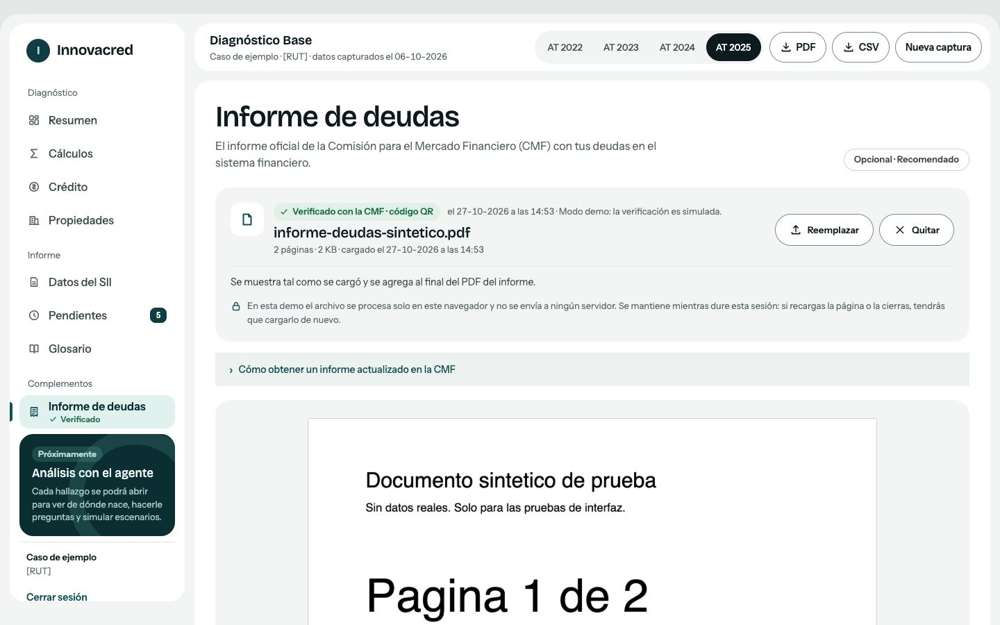 |

**Qué cambió**

- **Menú:** grupo nuevo "Complementos" con "Informe de deudas". Bajo la entrada se lee "Opcional · Recomendado", "Verificando…" o "Verificado". No cuenta como pendiente. Dirección: `#deudas`.
- **Guía:**
  - La URL exacta del portal, **https://conocetudeuda.cmfchile.cl/informe-deudas/**, con "Copiar enlace" y "Abrir el portal de la CMF".
  - Los pasos, tomados de la [ficha de ChileAtiende](https://www.chileatiende.gob.cl/fichas/2614-informe-de-deudas-del-sistema-financiero):
    1. entrar al portal;
    2. ingresar con ClaveÚnica;
    3. confirmar la identidad con el código que llega al correo;
    4. descargar el PDF;
    5. volver y cargarlo.
  - Requisitos, costo (gratis), qué contiene, desfase de 10 a 20 días y la línea de personas jurídicas.
  - "Innovacred no ve tu ClaveÚnica".
- **Carga:** arrastrar o "Elegir el PDF". Solo PDF, hasta 15 MB y 50 páginas; los errores aparecen junto al campo. Botones "Reemplazar" y "Quitar".
- **Tal como se cargó:** las páginas se dibujan con pdf.js (`pdfjs-dist`, Apache-2.0, cargado de forma diferida; decisión en `docs/decisions/0005-pdfjs-informe-de-deudas.md`).
- **Carpeta:** el PDF del informe termina con la sección "Informe de deudas (CMF)" y sus páginas. Si no se cargó, imprime la línea fija "No se cargó el informe de deudas; es opcional."
- **En la demo:** el archivo se procesa solo en el navegador, se mantiene mientras dura la sesión y se pierde al recargar. La vista lo dice.

**Criterios de aceptación**

- [ ] La URL exacta es visible; el enlace usa `target="_blank"` y `rel="noopener noreferrer"`.
- [ ] Rechaza archivos que no son PDF (`.txt` o un `.pdf` falso), con el mensaje junto al campo.
- [ ] Un PDF de 2 páginas se muestra completo y se mantiene al ir al Resumen y volver.
- [ ] La impresión incluye la sección con las páginas, o la línea fija.

**Por confirmar**

- Dónde se guardará el archivo con backend: almacenamiento, cifrado, retención y consentimiento.
- Probar con un informe real de la CMF (clave, fuentes o imágenes especiales). Hasta ahora solo se usó un PDF sintético.
- Los rótulos exactos de los botones del portal. El portal bloquea navegadores automatizados, así que los pasos describen la acción sin citar los rótulos.
- Los límites de 15 MB y 50 páginas.

**Archivos:**

- `src/components/deudas/DebtReportView.tsx`
- `src/context/DebtReportProvider.tsx` y `src/context/debtReport.ts`
- `src/lib/informeDeudas.ts` y `src/lib/pdfPages.ts`
- `src/styles/deudas.css`
- `e2e/deudas.spec.ts` y `e2e/fixtures/` (PDF sintético, sin datos reales)
- `design-system/risktech-ceft/pages/informe-de-deudas.md`

**Código** (commit 5757147)

| Pieza | Para qué sirve (UI/UX) | Código |
| --- | --- | --- |
| Vista Informe de deudas | UI/UX: estados vacía, cargando, cargada | [`DebtReportView.tsx` L23–179](https://github.com/coyane/risktech/blob/575714737a40ab53377b45f43f176f4b51fe956c/src/components/deudas/DebtReportView.tsx#L23-L179) |
| Guía de la CMF | UX: URL exacta, copiar, pasos y requisitos | [`DebtReportView.tsx` L307–398](https://github.com/coyane/risktech/blob/575714737a40ab53377b45f43f176f4b51fe956c/src/components/deudas/DebtReportView.tsx#L307-L398) |
| Zona de carga | UI/UX: arrastrar, elegir PDF, errores | [`DebtReportView.tsx` L400–459](https://github.com/coyane/risktech/blob/575714737a40ab53377b45f43f176f4b51fe956c/src/components/deudas/DebtReportView.tsx#L400-L459) |
| URL, límites y textos fijos | UX: todos los textos de la vista | [`informeDeudas.ts` L9–130](https://github.com/coyane/risktech/blob/575714737a40ab53377b45f43f176f4b51fe956c/src/lib/informeDeudas.ts#L9-L130) |
| Render de páginas con pdf.js | Lógica: carga diferida | [`pdfPages.ts` L1–66](https://github.com/coyane/risktech/blob/575714737a40ab53377b45f43f176f4b51fe956c/src/lib/pdfPages.ts#L1-L66) |
| Estado del archivo en la sesión | Lógica | [`DebtReportProvider.tsx` L29–212](https://github.com/coyane/risktech/blob/575714737a40ab53377b45f43f176f4b51fe956c/src/context/DebtReportProvider.tsx#L29-L212) |
| Sección en la carpeta (impresión) | UI: páginas al final del PDF | [`print.css` L295–334](https://github.com/coyane/risktech/blob/575714737a40ab53377b45f43f176f4b51fe956c/src/styles/print.css#L295-L334) |
| Estilos de la vista | UI | [`deudas.css` L1–692](https://github.com/coyane/risktech/blob/575714737a40ab53377b45f43f176f4b51fe956c/src/styles/deudas.css#L1-L692) |
| Reglas visuales de la página | Guía para devs y diseño | [`informe-de-deudas.md` L1–39](https://github.com/coyane/risktech/blob/575714737a40ab53377b45f43f176f4b51fe956c/design-system/risktech-ceft/pages/informe-de-deudas.md?plain=1#L1-L39) |
| Pruebas e2e del informe de deudas | — | [`deudas.spec.ts` L1–204](https://github.com/coyane/risktech/blob/575714737a40ab53377b45f43f176f4b51fe956c/e2e/deudas.spec.ts#L1-L204) |

---

## S3-09 · Verificación del informe de deudas por código QR

**Por qué.** El informe de la CMF trae un código QR. El backend lo leerá y validará que el documento sea legítimo, así que la persona tiene que ver ese proceso y su resultado. **Decisión de Cristóbal:** si la verificación falla por el documento, se rechaza; no se guarda ni entra a la carpeta.

**Contrato** (detalle en `docs/contrato-verificacion-informe-deudas.md`; en la demo, simulado en `src/lib/verificacionDeudas.ts`)

- **Funciones:**
  - `verifyDebtReport(file)` devuelve `{ id }`;
  - `getDebtVerification(id)` devuelve el trabajo, con sus pasos y su estado;
  - `cancelDebtVerification(id)`.
- **Pasos:** `LEER_PDF` ("Leyendo el PDF"), `BUSCAR_QR` ("Buscando el código QR") y `VALIDAR_CMF` ("Validando con la CMF").

| Estado final | Qué ve la persona | ¿Entra a la carpeta? |
| --- | --- | --- |
| `VERIFIED` | Sello "Verificado con la CMF · código QR" con fecha y hora; recién entonces aparecen las páginas | Sí, con la línea "Verificado con el código QR del documento el dd-mm-aaaa a las hh:mm" |
| `NO_QR` | "El documento no se aceptó": el PDF no trae el código QR | No; se descarta |
| `NOT_CMF` | El código QR no es de la CMF | No; se descarta |
| `MISMATCH` | El documento no coincide con lo registrado en la CMF | No; se descarta |
| `SERVICE_ERROR` | El servicio no respondió y no es culpa del documento: "Reintentar" | No, hasta reintentar |
| `CANCELLED` | La persona canceló | No |

- **Si se reemplaza un informe ya verificado,** el anterior se mantiene hasta que el nuevo quede verificado.
- **En la demo:** cualquier PDF válido termina en `VERIFIED` en unos 3 segundos, y la vista dice "Modo demo: la verificación es simulada". Los escenarios `?demo=deuda-sin-qr`, `deuda-no-cmf`, `deuda-no-coincide` y `deuda-servicio` muestran cada caso; el último falla la primera vez y "Reintentar" lo verifica.

**Criterios de aceptación**

- [ ] Los tres pasos se ven avanzar. El foco va al título del panel y el paso en curso se anuncia a lectores de pantalla.
- [ ] Cada rechazo muestra su motivo, "Cargar otro PDF" y "Abrir el portal de la CMF", y no deja archivo ni páginas.
- [ ] El error de servicio ofrece "Reintentar", que termina verificado.
- [ ] "Cancelar" no deja archivo.
- [ ] La impresión de un informe verificado trae la línea de verificación.

**Por confirmar (con quien construya la verificación)**

1. Qué contiene el QR (URL, folio o hash) y contra qué servicio de la CMF se valida.
2. Qué significa "no coincide": folio, RUT, fecha o contenido completo.
3. **Si el RUT del informe debe coincidir con el de la persona del diagnóstico.** Hoy no se compara; se recomienda hacerlo.
4. Si se envía el PDF completo o solo el contenido del QR. El texto de privacidad de la vista cambia cuando exista el backend.
5. Las rutas HTTP, el intervalo de consulta (hoy 400 ms), el tiempo máximo y la política de reintentos.

**Archivos:** `src/lib/verificacionDeudas.ts`, `src/context/DebtReportProvider.tsx`, `src/components/deudas/DebtReportView.tsx`, `docs/contrato-verificacion-informe-deudas.md`, `README.md` (escenarios).

**Código** (commit 5757147)

| Pieza | Para qué sirve (UI/UX) | Código |
| --- | --- | --- |
| Contrato simulado de verificación | Lógica: pasos, estados, escenarios de demo | [`verificacionDeudas.ts` L1–122](https://github.com/coyane/risktech/blob/575714737a40ab53377b45f43f176f4b51fe956c/src/lib/verificacionDeudas.ts#L1-L122) |
| Contrato para el backend | Documento | [`contrato-verificacion-informe-deudas.md` L1–68](https://github.com/coyane/risktech/blob/575714737a40ab53377b45f43f176f4b51fe956c/docs/contrato-verificacion-informe-deudas.md?plain=1#L1-L68) |
| Panel de verificación y resultados | UI/UX: pasos, sello, rechazos, reintentar | [`DebtReportView.tsx` L182–305](https://github.com/coyane/risktech/blob/575714737a40ab53377b45f43f176f4b51fe956c/src/components/deudas/DebtReportView.tsx#L182-L305) |
| Flujo de verificación (cancelar, reintentar, reemplazo) | Lógica | [`DebtReportProvider.tsx` L29–212](https://github.com/coyane/risktech/blob/575714737a40ab53377b45f43f176f4b51fe956c/src/context/DebtReportProvider.tsx#L29-L212) |
| Prueba e2e: verificado | — | [`deudas.spec.ts` L80–118](https://github.com/coyane/risktech/blob/575714737a40ab53377b45f43f176f4b51fe956c/e2e/deudas.spec.ts#L80-L118) |
| Prueba e2e: rechazos | — | [`deudas.spec.ts` L168–188](https://github.com/coyane/risktech/blob/575714737a40ab53377b45f43f176f4b51fe956c/e2e/deudas.spec.ts#L168-L188) |
| Prueba e2e: error de servicio y reintento | — | [`deudas.spec.ts` L191–204](https://github.com/coyane/risktech/blob/575714737a40ab53377b45f43f176f4b51fe956c/e2e/deudas.spec.ts#L191-L204) |

---

## S3-10 · Actividades económicas registradas

**Por qué.** Los códigos de actividad económica son clave y no se estaban considerando como corresponde. Se leían dentro del paso de bienes raíces, sin la columna "Afecta IVA", y solo se veían en Datos del SII.

| Antes | Ahora |
| --- | --- |
| 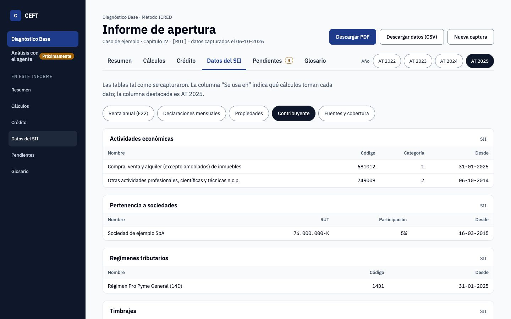 | 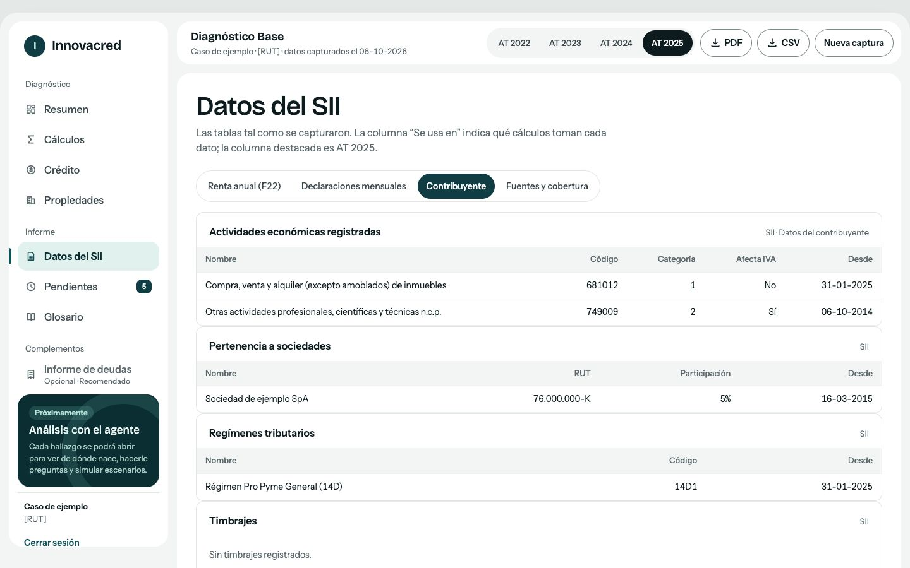 |

**Ruta de extracción.** sii.cl → Mi SII → "Datos del contribuyente" → al final de la página, la tabla **"Actividades económicas registradas"**. Se leen todas sus filas:

- código de actividad (6 dígitos);
- glosa;
- categoría;
- si afecta IVA (Sí/No);
- fecha de inicio.

**Qué cambió**

- **Extracción:** paso propio `CONTRIBUYENTE`, "Datos del contribuyente · Actividades económicas registradas e inicio de actividades", antes de `BIENES_RAICES`, que ahora se titula solo "Bienes raíces". La extracción pasa de 6 a 7 pasos (ver la captura de S3-02).
- **Si la tabla viene vacía,** la cobertura `ACTIVIDADES` queda `empty`. Si la página no responde, `failed`, y el run termina en `PARTIAL`.
- **Tipo:** `Activity` suma `afectaIva: boolean | null`.
- **Resumen:** tarjeta "Actividades económicas registradas" con el código grande, la glosa y "Categoría · Afecta IVA · Desde". Origen: "SII · Datos del contribuyente".
- **Datos del SII → Contribuyente:** columna "Afecta IVA".
- **Ingreso:** la lista de fuentes suma "Actividades".
- **Glosario:** "Actividad económica" y "Afecta IVA".
- **En el caso de ejemplo,** los valores de "Afecta IVA" son ilustrativos.

**Criterios de aceptación**

- [ ] La extracción muestra "Datos del contribuyente" antes de "Bienes raíces". Los escenarios `?demo=fallo` y `?demo=parcial` siguen deteniéndose donde corresponde.
- [ ] El Resumen muestra 681012 y 749009 con categoría, Afecta IVA y fecha.
- [ ] Datos del SII muestra la columna "Afecta IVA".

**Por confirmar**

- **Consentimiento:** el texto dice "consultar mis declaraciones y bienes raíces" y no menciona las actividades. ¿Se amplía?
- **Categoría:** se muestra tal cual ("1" o "2"). ¿Se traduce a "Primera" y "Segunda categoría"?

**Archivos:** `src/types.ts`, `src/data/demo.json` (paso, log, fuentes y `afectaIva`), `src/pages/DiagnosticoPage.tsx`, `src/components/diagnostico/SiiTables.tsx`, `src/data/glosario.ts`, `docs/sprint-1-v2-diagnostico-base-y-backoffice.md` (SII-07 y la ruta).

**Código** (commit 5757147)

| Pieza | Para qué sirve (UI/UX) | Código |
| --- | --- | --- |
| Tipo Activity (afectaIva) | Contrato de datos | [`types.ts` L109–116](https://github.com/coyane/risktech/blob/575714737a40ab53377b45f43f176f4b51fe956c/src/types.ts#L109-L116) |
| Paso CONTRIBUYENTE de la extracción | Datos de demo: paso y log | [`demo.json` L1537–1540](https://github.com/coyane/risktech/blob/575714737a40ab53377b45f43f176f4b51fe956c/src/data/demo.json#L1537-L1540) |
| Tarjeta del Resumen | UI: código, glosa, categoría, Afecta IVA, desde | [`DiagnosticoPage.tsx` L778–820](https://github.com/coyane/risktech/blob/575714737a40ab53377b45f43f176f4b51fe956c/src/pages/DiagnosticoPage.tsx#L778-L820) |
| Textos fijos de actividades | UX | [`calculos.ts` L173–178](https://github.com/coyane/risktech/blob/575714737a40ab53377b45f43f176f4b51fe956c/src/lib/calculos.ts#L173-L178) |
| Tabla en Datos del SII | UI: columna Afecta IVA | [`SiiTables.tsx` L207–323](https://github.com/coyane/risktech/blob/575714737a40ab53377b45f43f176f4b51fe956c/src/components/diagnostico/SiiTables.tsx#L207-L323) |
| Glosario | UX: Actividad económica y Afecta IVA | [`glosario.ts` L24–32](https://github.com/coyane/risktech/blob/575714737a40ab53377b45f43f176f4b51fe956c/src/data/glosario.ts#L24-L32) |
| Ruta de extracción (SII-07) | Documento | [`sprint-1-v2-diagnostico-base-y-backoffice.md` L218](https://github.com/coyane/risktech/blob/575714737a40ab53377b45f43f176f4b51fe956c/docs/sprint-1-v2-diagnostico-base-y-backoffice.md?plain=1#L218) |
| Prueba e2e: tarjeta en el Resumen | — | [`diagnostico.spec.ts` L235–253](https://github.com/coyane/risktech/blob/575714737a40ab53377b45f43f176f4b51fe956c/e2e/diagnostico.spec.ts#L235-L253) |
| Prueba e2e: paso en la extracción | — | [`diagnostico.spec.ts` L276–289](https://github.com/coyane/risktech/blob/575714737a40ab53377b45f43f176f4b51fe956c/e2e/diagnostico.spec.ts#L276-L289) |

---

## S3-11 · Landing e ingreso (siguiente sprint)

**Estado.** Hay tres prototipos HTML locales (Trazado, Expediente y Respuesta), cada uno con su landing y su pantalla de ingreso. Todavía no están en el repositorio. Se recomienda **V2 Expediente**: el F22 que se enciende fila por fila y alimenta el diagnóstico, y una autorización que se lee como documento, con el formulario flotante. La bitácora de la clave ya incorpora el documento técnico del conector:

- la clave viaja cifrada (TLS);
- el navegador la borra cuando el proceso de consulta acepta el trabajo;
- hay un solo intento de ingreso al SII;
- al terminar se cierran la sesión del SII y el navegador;
- la clave nunca se guarda en disco, en registros ni en servidores, y una prueba dedicada lo verifica.

**Pendiente:** elegir la versión, pasarla a Astro y cerrar los [por confirmar] legales y de privacidad:

- Ley 19.628 y Ley 21.719;
- revocación de la autorización;
- dónde y por cuánto tiempo se guardan las declaraciones leídas;
- "no se comparten con terceros";
- razón social y textos legales del pie.

No se publica nada con afirmaciones sin confirmar.

---

## Lo que se probó y se descartó en este sprint

Está registrado en `docs/ui.md` ("Descartado, para no repetirlo").

- **Resumen en cinco pasos** con línea técnica, frases puente y columna lateral: sobrecargado.
- **Tres prototipos completos:**
  - Boleta: suma vertical;
  - Tablero: bento con fórmula grande;
  - Margen: editorial oscuro con notas al margen.

  No cumplían; el panel actual parte de Tablero.
- **Gráficos que no respondían una pregunta:** mini tendencias, medio anillo, columnas que mezclaban montos anuales y mensuales, cápsulas de leverage, mini barras sin cifra y barras para conteos de 1 a 6.
- **Nombrar el método en la interfaz.**

## Verificación del estado actual

| Comprobación | Resultado |
| --- | --- |
| `npm run verify` (tipos, lint, unitarias y build) | 39 pruebas unitarias en verde, sin avisos de lint |
| `npm run test:ui` (Chrome a 1440 y 375 px) | 87 en verde, más 1 omitida a propósito (solo corre en escritorio) |
| PDF del informe | 43 hojas con el informe de deudas cargado; todos los cálculos con su operación y su origen |
| Dependencias de producción | `npm audit`: 0 vulnerabilidades |

Pendiente para todo el sprint: la **revisión independiente** que pide `AGENTS.md` (sección 7). Lo hecho hasta ahora es autorrevisión.

## Por confirmar, consolidado

| Tema | Pregunta | Ticket |
| --- | --- | --- |
| Plazo del crédito | ¿Se acepta suponer pagos al día? ¿Hay otra fuente de dividendos pagados? | S3-07 |
| Verificación QR | Contenido del QR y servicio de la CMF; qué es "no coincide"; ¿comparar el RUT? | S3-09 |
| Informe de deudas | Almacenamiento, cifrado, retención y consentimiento; prueba con un informe real; límites de tamaño | S3-08, S3-09 |
| Actividades | ¿Ampliar el consentimiento? ¿Traducir la categoría? | S3-10 |
| Landing | Marco legal, revocación, retención y textos legales | S3-11 |
| Bitácora de la extracción | "Tasa efectiva subió de 6,9% a 16,0%" usa "subió": ¿pasarlo a dato neutro? | S3-01 |
